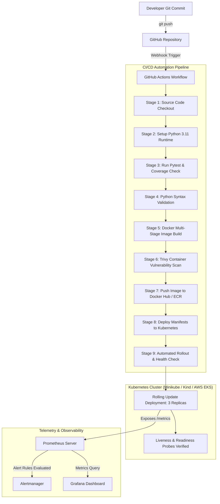
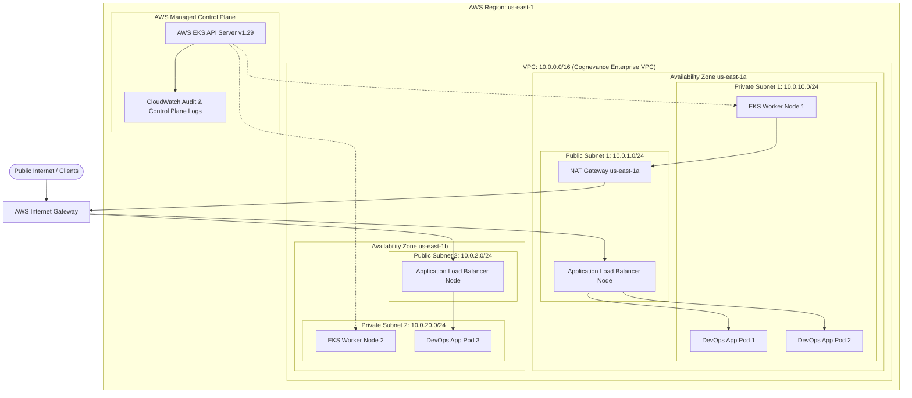
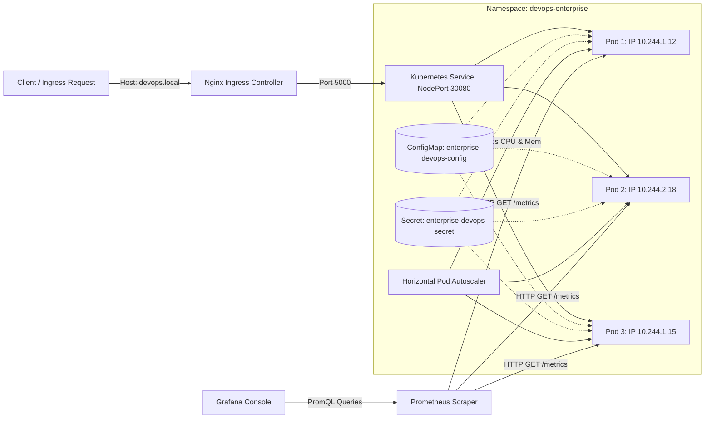

# Cloud Architecture & DevOps Automation Diagrams
Organization: Cognevance Technologies

This document outlines the architectural blueprint, data flow, and networking topologies across the Enterprise Cloud and DevOps environment.

---

## 1. End-to-End DevOps Lifecycle Pipeline

The diagram below illustrates the developer lifecycle from code commit to automated testing, container scanning, registry publishing, and Kubernetes rollout.

---

## 2. AWS Cloud Infrastructure Architecture (Terraform Provisioned)

The cloud architecture is designed across two Availability Zones for high availability and fault isolation.

---

## 3. Kubernetes Pod Networking & Observability Architecture

